# ClickHouse and Elasticsearch columnar / full-text, 1–20 GB

Elasticsearch has [columnar storage](https://www.elastic.co/search-labs/blog/elasticsearch-columnar-storage) that stores field values together, the same idea as ClickHouse columns. This run loads one synthetic log corpus into both engines, in several layouts, and asks two questions: how much disk each layout uses, and whether a word search actually uses a word index.

The 1 GB prefix was measured on Colima at 2 CPU / 2 GB. The 2, 5, and 10 GB prefixes were measured on 4 CPU / 12 GB. The 20 GB prefix was measured on 6 CPU / 18 GB, 300 GB disk. Storage bytes can be compared across sizes. Search times from 1 GB sit on a smaller VM and are not a hardware-fair scaling curve. None of these numbers fill [columnar-fulltext-spec.md](../columnar-fulltext-spec.md) §13 (that table wants 16 cores / 64 GB).

## TL;DR

| | 1 GB | 2 GB | 5 GB | 10 GB | 20 GB |
| --- | ---: | ---: | ---: | ---: | ---: |
| Events | 2,016,000 | 4,024,000 | 10,064,000 | 20,120,000 | 40,232,000 |
| Gate | passed | passed | passed | passed | passed |
| Closest ES/CH arm | ng 1.02× | ng 1.14× | ng 1.02× | ng 1.07× | ng 1.09× |
| Widest ES/CH arm | scan 1.53× | scan 1.59× | scan 1.60× | scan 1.55× | scan 1.56× |
| Token `zzq_s5` in dc1 | 16 | 31 | 79 | 157 | 312 |
| Substring `abc` / token `abc` | 20 / 0 | 40 / 0 | 101 / 0 | 201 / 0 | 403 / 0 |

N-gram is the closest on-disk layout at every size. Scan is the widest, because Elasticsearch keeps a doc-values copy of every typed field. A word search uses the word index; a character search uses the n-gram index; the same character sequence inside a longer token does not hit the word index.

## In plain language

Each **arm** is the same pile of log lines stored a different way. `col` keeps typed fields (cluster, status, duration) easy to filter and does not index the words in the message. `ft` builds a **word index**: a dictionary of tokens that points at the lines containing each word. `phrase` (Elasticsearch only) also stores word order, so "connection refused" is two words next to each other, not just both present. `ng` indexes every overlapping 3-character slice, which finds `abc` inside `traceabc`. `scan` stores the message and reads it; it is the control that shows what the indexes are saving you from.

A **token** is a word after splitting on anything that is not `0-9A-Za-z`. `zzq_s5` becomes `zzq` and `s5`. A **substring** search looks at characters, not words. **Doc values** are Elasticsearch's column-like copy of a field. **Inverted** bytes are the word/n-gram dictionary. **Wall time** is how long you wait. **CPU-seconds** is how much processor time ClickHouse used; Elasticsearch CPU was not sampled on this host.

| Arm | What ClickHouse stores | What Elasticsearch stores | What a search does |
| --- | --- | --- | --- |
| col | Columns plus a bloom filter on `TraceId`. No index on the log line. | `body` is a keyword that is not inverted. Values live in doc values. | Filters on typed fields. Reading the message is extra. |
| ft | `idx_body`, a skip index of tokens (`splitByNonAlpha`). | `body` is `match_only_text` (tokens, no word positions). | "Does this line contain these words?" |
| phrase | No extra table. The phrase query runs on `ch-ft` by scanning the line. | `body` is `text` with positions. | "Are these words next to each other?" |
| ng | `idx_ng`, every overlapping 3-character slice. | `body` is a `wildcard` field. | "Does this character sequence appear, even inside a longer token?" |
| scan | The `Body` column only. | `body` is an unindexed keyword; a script reads doc values. | Same question as `ft` / `ng`, answered by reading the raw line. |

## How the test is checked

The 2, 5, 10, and 20 GB files are **nested prefixes** of one 7-day corpus: the 2 GB file starts with the 1 GB file, the 5 GB file starts with the 2 GB file, and so on. Same time window, more events per hour. The needles (`zzq_s5`, `connection refused`, `abc` inside `traceabc`) are planted at a known rate, so the expected hit count is in `manifest.json` and `incidents.json` for that size.

A size is accepted only when all of this holds:

1. Tokenizer: 10 fixture lines produce the same tokens in Python, ClickHouse `splitByNonAlpha`, and the Elasticsearch analyzer.
2. Load: every arm has exactly `manifest.event_count` rows.
3. Multiline: the sample stack-trace body comes back as one event, with the original newlines.
4. Point lookup: one known `trace_id` returns the same body on both engines.
5. Query counts: C1, C2, F1, F2, F4, F5, F6, F6-token match the per-hour totals in the manifest, on every arm that claims that meaning.
6. Incident C6: hourly `payment-api` rejected counts match INC-2.
7. Search: the timed repetitions of a query all return that same count.

The query text is frozen at 1 GB in `driver/queries.py`. Larger sizes reuse that text; they do not rewrite it.

## Corpus

| Size | Events | Raw JSONL bytes | sha256 |
| --- | ---: | ---: | --- |
| 1 GB | 2,016,000 | 1,002,338,234 | `67682d737621f8ddb75e2d35a47f04c61249aab6486e08e2231fd138de4d1734` |
| 2 GB | 4,024,000 | 2,000,712,994 | `8236eedc0663148c261c959ef37fd4cb88f30ef881219e6bc6d19aad974040f4` |
| 5 GB | 10,064,000 | 5,003,782,406 | `38246f605ba7a86aa7b594d1756c1b509a4b186f60c3c47614fc16f24fea2d1b` |
| 10 GB | 20,120,000 | 10,003,614,383 | `8b778775ce75d65a3ca2f76b0ae9f8e7501b7c72cd34e376be291a90f6ed0b82` |
| 20 GB | 40,232,000 | 20,003,328,681 | `685f428476f5b7969c5a2ffbd2938027be3774ab07f5d5310e56351a0e9f2d35` |

Engines: ClickHouse 26.2.19.43, Elasticsearch 9.5.5 `logsdb_columnar`, one shard, zero replicas. One engine process at a time. Merges idle. No `force_merge`. Search window is 7 days, `2026-09-01` through `2026-09-08`. Three repetitions after that engine restarted; page cache left in place. Warm time is the median of repetitions 2 and 3.

## Storage by arm

Disk after the load, with merges idle. `phrase` exists only on Elasticsearch; ClickHouse answers the phrase query from `ch-ft`.

### ClickHouse total bytes

| Arm | 1 GB | 2 GB | 5 GB | 10 GB | 20 GB |
| --- | ---: | ---: | ---: | ---: | ---: |
| ch-col | 141,630,835 | 274,948,912 | 682,253,780 | 1,337,594,342 | 2,645,548,369 |
| ch-ft | 165,256,919 | 318,712,975 | 792,859,448 | 1,543,073,705 | 3,040,219,106 |
| ch-ng | 247,277,238 | 482,381,605 | 1,153,675,887 | 2,143,362,519 | 4,286,239,922 |
| ch-scan | 139,096,666 | 269,892,116 | 669,610,206 | 1,312,318,494 | 2,592,657,456 |

### Elasticsearch total bytes

| Arm | 1 GB | 2 GB | 5 GB | 10 GB | 20 GB |
| --- | ---: | ---: | ---: | ---: | ---: |
| es-col | 201,012,637 | 428,980,653 | 953,351,789 | 1,919,741,470 | 3,803,246,832 |
| es-ft | 219,336,457 | 468,398,443 | 1,025,492,699 | 2,048,677,093 | 4,146,007,787 |
| es-phrase | 243,550,248 | 503,004,595 | 1,125,258,777 | 2,253,755,727 | 4,498,759,055 |
| es-ng | 253,352,163 | 550,392,277 | 1,176,218,622 | 2,288,614,197 | 4,693,147,110 |
| es-scan | 213,081,473 | 428,860,566 | 1,072,055,242 | 2,033,956,235 | 4,036,825,623 |

### ES / CH at each size

| Arm | 1 GB | 2 GB | 5 GB | 10 GB | 20 GB |
| --- | ---: | ---: | ---: | ---: | ---: |
| col | 1.42× | 1.56× | 1.40× | 1.44× | 1.44× |
| ft | 1.33× | 1.47× | 1.29× | 1.33× | 1.36× |
| ng | 1.02× | 1.14× | 1.02× | 1.07× | 1.09× |
| scan | 1.53× | 1.59× | 1.60× | 1.55× | 1.56× |

### 1 GB total size

| Arm | ClickHouse bytes | ClickHouse per raw GB | Elasticsearch bytes | Elasticsearch per raw GB | ES / CH |
| --- | ---: | ---: | ---: | ---: | ---: |
| col | 141,630,835 | 141.3 MB | 201,012,637 | 200.5 MB | 1.42× |
| ft | 165,256,919 | 164.9 MB | 219,336,457 | 218.8 MB | 1.33× |
| phrase | — | — | 243,550,248 | 243.0 MB | — |
| ng | 247,277,238 | 246.7 MB | 253,352,163 | 252.8 MB | 1.02× |
| scan | 139,096,666 | 138.8 MB | 213,081,473 | 212.6 MB | 1.53× |

```mermaid
xychart-beta
    title "On-disk size at 1 GB (MB)"
    x-axis [col, ft, phrase, ng, scan]
    y-axis "MB"
    bar [141.6, 165.3, 0, 247.3, 139.1]
    bar [201.0, 219.3, 243.6, 253.4, 213.1]
```

First bar is ClickHouse, second bar is Elasticsearch. `phrase` has no ClickHouse table; that query runs on `ch-ft`.

#### ClickHouse at 1 GB

| Arm | Inverted | All columns | Body column | Remainder | Parts |
| --- | ---: | ---: | ---: | ---: | ---: |
| ch-col | 2,534,169 | 116,265,979 | 15,347,851 | 22,830,687 | 27 |
| ch-ft | 26,160,253 | 116,265,979 | 15,347,851 | 22,830,687 | 27 |
| ch-ng | 106,458,860 | 74,666,442 | 9,854,014 | 66,151,936 | 34 |
| ch-scan | 0 | 116,265,979 | 15,347,851 | 22,830,687 | 27 |

#### Elasticsearch at 1 GB

| Arm | Inverted | Doc values | Points | Stored fields | Store size |
| --- | ---: | ---: | ---: | ---: | ---: |
| es-col | 6,539,051 | 194,411,818 | 0 | 0 | 201,012,637 |
| es-ft | 24,060,167 | 195,066,144 | 0 | 0 | 219,336,457 |
| es-phrase | 41,886,423 | 201,420,501 | 0 | 0 | 243,550,248 |
| es-ng | 52,739,844 | 200,524,966 | 0 | 0 | 253,352,163 |
| es-scan | 5,747,926 | 206,892,156 | 0 | 0 | 213,081,473 |

#### Body field at 1 GB

| Arm | Body inverted | Body doc values | ClickHouse Body column |
| --- | ---: | ---: | ---: |
| col | 0 | 9,369,882 | 15,347,851 |
| ft | 17,526,369 | 9,400,552 | 15,347,851 |
| phrase | 35,396,305 | 9,552,038 | — |
| ng | 46,209,559 | 9,396,516 | 9,854,014 |
| scan | 0 | 10,535,157 | 15,347,851 |

### 2 GB total size

| Arm | ClickHouse bytes | ClickHouse per raw GB | Elasticsearch bytes | Elasticsearch per raw GB | ES / CH |
| --- | ---: | ---: | ---: | ---: | ---: |
| col | 274,948,912 | 137.4 MB | 428,980,653 | 214.4 MB | 1.56× |
| ft | 318,712,975 | 159.3 MB | 468,398,443 | 234.1 MB | 1.47× |
| phrase | — | — | 503,004,595 | 251.4 MB | — |
| ng | 482,381,605 | 241.1 MB | 550,392,277 | 275.1 MB | 1.14× |
| scan | 269,892,116 | 134.9 MB | 428,860,566 | 214.4 MB | 1.59× |

```mermaid
xychart-beta
    title "On-disk size at 2 GB (MB)"
    x-axis [col, ft, phrase, ng, scan]
    y-axis "MB"
    bar [274.9, 318.7, 0, 482.4, 269.9]
    bar [429.0, 468.4, 503.0, 550.4, 428.9]
```

First bar is ClickHouse, second bar is Elasticsearch. `phrase` has no ClickHouse table; that query runs on `ch-ft`.

#### ClickHouse at 2 GB

| Arm | Inverted | All columns | Body column | Remainder | Parts |
| --- | ---: | ---: | ---: | ---: | ---: |
| ch-col | 5,056,796 | 243,050,813 | 30,145,172 | 26,841,303 | 35 |
| ch-ft | 51,731,190 | 258,355,737 | 31,895,465 | 8,626,048 | 35 |
| ch-ng | 206,457,821 | 223,964,628 | 29,407,260 | 51,959,156 | 56 |
| ch-scan | 0 | 243,050,813 | 30,145,172 | 26,841,303 | 35 |

#### Elasticsearch at 2 GB

| Arm | Inverted | Doc values | Points | Stored fields | Store size |
| --- | ---: | ---: | ---: | ---: | ---: |
| es-col | 11,704,496 | 417,093,946 | 0 | 0 | 428,980,653 |
| es-ft | 50,735,244 | 417,033,063 | 0 | 0 | 468,398,443 |
| es-phrase | 85,255,805 | 417,089,502 | 0 | 0 | 503,004,595 |
| es-ng | 133,537,247 | 416,667,984 | 0 | 0 | 550,392,277 |
| es-scan | 11,698,167 | 416,956,938 | 0 | 0 | 428,860,566 |

#### Body field at 2 GB

| Arm | Body inverted | Body doc values | ClickHouse Body column |
| --- | ---: | ---: | ---: |
| col | 0 | 21,795,044 | 30,145,172 |
| ft | 39,035,679 | 21,738,798 | 31,895,465 |
| phrase | 73,568,308 | 21,887,820 | — |
| ng | 121,844,240 | 21,702,133 | 29,407,260 |
| scan | 0 | 21,793,219 | 30,145,172 |

### 5 GB total size

| Arm | ClickHouse bytes | ClickHouse per raw GB | Elasticsearch bytes | Elasticsearch per raw GB | ES / CH |
| --- | ---: | ---: | ---: | ---: | ---: |
| col | 682,253,780 | 136.3 MB | 953,351,789 | 190.5 MB | 1.40× |
| ft | 792,859,448 | 158.5 MB | 1,025,492,699 | 204.9 MB | 1.29× |
| phrase | — | — | 1,125,258,777 | 224.9 MB | — |
| ng | 1,153,675,887 | 230.6 MB | 1,176,218,622 | 235.1 MB | 1.02× |
| scan | 669,610,206 | 133.8 MB | 1,072,055,242 | 214.2 MB | 1.60× |

```mermaid
xychart-beta
    title "On-disk size at 5 GB (MB)"
    x-axis [col, ft, phrase, ng, scan]
    y-axis "MB"
    bar [682.3, 792.9, 0, 1153.7, 669.6]
    bar [953.4, 1025.5, 1125.3, 1176.2, 1072.1]
```

First bar is ClickHouse, second bar is Elasticsearch. `phrase` has no ClickHouse table; that query runs on `ch-ft`.

#### ClickHouse at 5 GB

| Arm | Inverted | All columns | Body column | Remainder | Parts |
| --- | ---: | ---: | ---: | ---: | ---: |
| ch-col | 12,643,574 | 669,570,685 | 82,537,906 | 39,521 | 37 |
| ch-ft | 128,648,572 | 659,723,457 | 80,359,868 | 4,487,419 | 42 |
| ch-ng | 485,976,914 | 617,864,797 | 73,364,554 | 49,834,176 | 48 |
| ch-scan | 0 | 669,570,685 | 82,537,906 | 39,521 | 37 |

#### Elasticsearch at 5 GB

| Arm | Inverted | Doc values | Points | Stored fields | Store size |
| --- | ---: | ---: | ---: | ---: | ---: |
| es-col | 34,452,380 | 918,824,221 | 0 | 0 | 953,351,789 |
| es-ft | 97,994,227 | 927,204,599 | 0 | 0 | 1,025,492,699 |
| es-phrase | 181,503,183 | 943,271,250 | 0 | 0 | 1,125,258,777 |
| es-ng | 232,244,434 | 943,808,292 | 0 | 0 | 1,176,218,622 |
| es-scan | 29,277,868 | 1,042,306,772 | 0 | 0 | 1,072,055,242 |

#### Body field at 5 GB

| Arm | Body inverted | Body doc values | ClickHouse Body column |
| --- | ---: | ---: | ---: |
| col | 0 | 42,490,403 | 82,537,906 |
| ft | 63,984,387 | 43,528,443 | 80,359,868 |
| phrase | 148,167,376 | 44,630,126 | — |
| ng | 198,892,674 | 44,552,558 | 73,364,554 |
| scan | 0 | 54,303,792 | 82,537,906 |

### 10 GB total size

| Arm | ClickHouse bytes | ClickHouse per raw GB | Elasticsearch bytes | Elasticsearch per raw GB | ES / CH |
| --- | ---: | ---: | ---: | ---: | ---: |
| col | 1,337,594,342 | 133.7 MB | 1,919,741,470 | 191.9 MB | 1.44× |
| ft | 1,543,073,705 | 154.3 MB | 2,048,677,093 | 204.8 MB | 1.33× |
| phrase | — | — | 2,253,755,727 | 225.3 MB | — |
| ng | 2,143,362,519 | 214.3 MB | 2,288,614,197 | 228.8 MB | 1.07× |
| scan | 1,312,318,494 | 131.2 MB | 2,033,956,235 | 203.3 MB | 1.55× |

```mermaid
xychart-beta
    title "On-disk size at 10 GB (MB)"
    x-axis [col, ft, phrase, ng, scan]
    y-axis "MB"
    bar [1337.6, 1543.1, 0, 2143.4, 1312.3]
    bar [1919.7, 2048.7, 2253.8, 2288.6, 2034.0]
```

First bar is ClickHouse, second bar is Elasticsearch. `phrase` has no ClickHouse table; that query runs on `ch-ft`.

#### ClickHouse at 10 GB

| Arm | Inverted | All columns | Body column | Remainder | Parts |
| --- | ---: | ---: | ---: | ---: | ---: |
| ch-col | 25,275,848 | 1,283,896,319 | 149,718,372 | 28,422,175 | 65 |
| ch-ft | 242,669,952 | 1,272,865,769 | 145,752,741 | 27,537,984 | 51 |
| ch-ng | 866,055,124 | 1,237,308,806 | 134,746,345 | 39,998,589 | 38 |
| ch-scan | 0 | 1,283,896,319 | 149,718,372 | 28,422,175 | 65 |

#### Elasticsearch at 10 GB

| Arm | Inverted | Doc values | Points | Stored fields | Store size |
| --- | ---: | ---: | ---: | ---: | ---: |
| es-col | 68,405,914 | 1,851,173,969 | 0 | 0 | 1,919,741,470 |
| es-ft | 194,495,647 | 1,853,638,469 | 0 | 0 | 2,048,677,093 |
| es-phrase | 362,095,467 | 1,890,718,107 | 0 | 0 | 2,253,755,727 |
| es-ng | 430,486,252 | 1,857,937,942 | 0 | 0 | 2,288,614,197 |
| es-scan | 63,201,019 | 1,970,200,467 | 0 | 0 | 2,033,956,235 |

#### Body field at 10 GB

| Arm | Body inverted | Body doc values | ClickHouse Body column |
| --- | ---: | ---: | ---: |
| col | 0 | 86,092,731 | 149,718,372 |
| ft | 126,312,752 | 86,654,567 | 145,752,741 |
| phrase | 295,424,844 | 89,190,875 | — |
| ng | 362,431,821 | 86,989,395 | 134,746,345 |
| scan | 0 | 97,794,282 | 149,718,372 |

### 20 GB total size

| Arm | ClickHouse bytes | ClickHouse per raw GB | Elasticsearch bytes | Elasticsearch per raw GB | ES / CH |
| --- | ---: | ---: | ---: | ---: | ---: |
| col | 2,645,548,369 | 132.3 MB | 3,803,246,832 | 190.1 MB | 1.44× |
| ft | 3,040,219,106 | 152.0 MB | 4,146,007,787 | 207.3 MB | 1.36× |
| phrase | — | — | 4,498,759,055 | 224.9 MB | — |
| ng | 4,286,239,922 | 214.3 MB | 4,693,147,110 | 234.6 MB | 1.09× |
| scan | 2,592,657,456 | 129.6 MB | 4,036,825,623 | 201.8 MB | 1.56× |

```mermaid
xychart-beta
    title "On-disk size at 20 GB (MB)"
    x-axis [col, ft, phrase, ng, scan]
    y-axis "MB"
    bar [2645.5, 3040.2, 0, 4286.2, 2592.7]
    bar [3803.2, 4146.0, 4498.8, 4693.1, 4036.8]
```

First bar is ClickHouse, second bar is Elasticsearch. `phrase` has no ClickHouse table; that query runs on `ch-ft`.

#### ClickHouse at 20 GB

| Arm | Inverted | All columns | Body column | Remainder | Parts |
| --- | ---: | ---: | ---: | ---: | ---: |
| ch-col | 50,537,012 | 2,575,182,819 | 292,350,086 | 19,828,538 | 67 |
| ch-ft | 469,484,089 | 2,543,564,604 | 282,437,704 | 27,170,413 | 44 |
| ch-ng | 1,732,300,274 | 2,513,596,633 | 275,157,231 | 40,343,015 | 53 |
| ch-scan | 0 | 2,575,555,931 | 291,794,799 | 17,101,525 | 61 |

#### Elasticsearch at 20 GB

| Arm | Inverted | Doc values | Points | Stored fields | Store size |
| --- | ---: | ---: | ---: | ---: | ---: |
| es-col | 136,462,814 | 3,666,398,439 | 0 | 0 | 3,803,246,832 |
| es-ft | 408,190,459 | 3,736,095,648 | 0 | 0 | 4,146,007,787 |
| es-phrase | 729,309,809 | 3,767,381,562 | 0 | 0 | 4,498,759,055 |
| es-ng | 943,918,290 | 3,748,717,043 | 0 | 0 | 4,693,147,110 |
| es-scan | 128,550,110 | 3,907,395,356 | 0 | 0 | 4,036,825,623 |

#### Body field at 20 GB

| Arm | Body inverted | Body doc values | ClickHouse Body column |
| --- | ---: | ---: | ---: |
| col | 0 | 169,959,546 | 292,350,086 |
| ft | 273,114,680 | 174,821,503 | 282,437,704 |
| phrase | 595,786,483 | 176,897,460 | — |
| ng | 809,846,851 | 176,565,248 | 275,157,231 |
| scan | 0 | 189,858,564 | 291,794,799 |

## Verification

### 1 GB

Corpus sha256 `67682d737621f8ddb75e2d35a47f04c61249aab6486e08e2231fd138de4d1734`, 2,016,000 events, 1,002,338,234 raw JSONL bytes. Gate `passed=True`.

| Check | Expected | Got |
| --- | ---: | --- |
| ClickHouse col row count | 2,016,000 | clickhouse=2,016,000 |
| ClickHouse token-index row count | 2,016,000 | clickhouse=2,016,000 |
| ClickHouse n-gram row count | 2,016,000 | clickhouse=2,016,000 |
| ClickHouse scan row count | 2,016,000 | clickhouse=2,016,000 |
| Elasticsearch col doc count | 2,016,000 | elasticsearch=2,016,000 |
| Elasticsearch token-index doc count | 2,016,000 | elasticsearch=2,016,000 |
| Elasticsearch phrase doc count | 2,016,000 | elasticsearch=2,016,000 |
| Elasticsearch n-gram doc count | 2,016,000 | elasticsearch=2,016,000 |
| Elasticsearch scan doc count | 2,016,000 | elasticsearch=2,016,000 |
| cluster=dc1 in 7 days | 1,568,000 | ch-col=1,568,000, es-col=1,568,000 |
| token zzq_s5 in dc1, 7 days | 16 | ch-ft=16, ch-scan=16, es-ft=16, es-scan=16 |
| phrase connection refused, 7 days | 8,064 | ch-ft=8,064, es-ft=8,064, es-phrase=8,064 |
| substring abc, 7 days | 20 | ch-ng=20, ch-scan=20, es-ng=20, es-scan=20 |
| token abc, 7 days | 0 | ch-ft=0, es-ft=0 |

Every arm in a row had to equal the expected value or the run stopped. C6 hourly rejection counts and the sample stack-trace body were checked as well.

### 2 GB

Corpus sha256 `8236eedc0663148c261c959ef37fd4cb88f30ef881219e6bc6d19aad974040f4`, 4,024,000 events, 2,000,712,994 raw JSONL bytes. Gate `passed=True`.

| Check | Expected | Got |
| --- | ---: | --- |
| ClickHouse col row count | 4,024,000 | clickhouse=4,024,000 |
| ClickHouse token-index row count | 4,024,000 | clickhouse=4,024,000 |
| ClickHouse n-gram row count | 4,024,000 | clickhouse=4,024,000 |
| ClickHouse scan row count | 4,024,000 | clickhouse=4,024,000 |
| Elasticsearch col doc count | 4,024,000 | elasticsearch=4,024,000 |
| Elasticsearch token-index doc count | 4,024,000 | elasticsearch=4,024,000 |
| Elasticsearch phrase doc count | 4,024,000 | elasticsearch=4,024,000 |
| Elasticsearch n-gram doc count | 4,024,000 | elasticsearch=4,024,000 |
| Elasticsearch scan doc count | 4,024,000 | elasticsearch=4,024,000 |
| cluster=dc1 in 7 days | 3,129,800 | ch-col=3,129,800, es-col=3,129,800 |
| token zzq_s5 in dc1, 7 days | 31 | ch-ft=31, ch-scan=31, es-ft=31, es-scan=31 |
| phrase connection refused, 7 days | 16,096 | ch-ft=16,096, es-ft=16,096, es-phrase=16,096 |
| substring abc, 7 days | 40 | ch-ng=40, ch-scan=40, es-ng=40, es-scan=40 |
| token abc, 7 days | 0 | ch-ft=0, es-ft=0 |

Every arm in a row had to equal the expected value or the run stopped. C6 hourly rejection counts and the sample stack-trace body were checked as well.

### 5 GB

Corpus sha256 `38246f605ba7a86aa7b594d1756c1b509a4b186f60c3c47614fc16f24fea2d1b`, 10,064,000 events, 5,003,782,406 raw JSONL bytes. Gate `passed=True`.

| Check | Expected | Got |
| --- | ---: | --- |
| ClickHouse col row count | 10,064,000 | clickhouse=10,064,000 |
| ClickHouse token-index row count | 10,064,000 | clickhouse=10,064,000 |
| ClickHouse n-gram row count | 10,064,000 | clickhouse=10,064,000 |
| ClickHouse scan row count | 10,064,000 | clickhouse=10,064,000 |
| Elasticsearch col doc count | 10,064,000 | elasticsearch=10,064,000 |
| Elasticsearch token-index doc count | 10,064,000 | elasticsearch=10,064,000 |
| Elasticsearch phrase doc count | 10,064,000 | elasticsearch=10,064,000 |
| Elasticsearch n-gram doc count | 10,064,000 | elasticsearch=10,064,000 |
| Elasticsearch scan doc count | 10,064,000 | elasticsearch=10,064,000 |
| cluster=dc1 in 7 days | 7,827,600 | ch-col=7,827,600, es-col=7,827,600 |
| token zzq_s5 in dc1, 7 days | 79 | ch-ft=79, ch-scan=79, es-ft=79, es-scan=79 |
| phrase connection refused, 7 days | 40,256 | ch-ft=40,256, es-ft=40,256, es-phrase=40,256 |
| substring abc, 7 days | 101 | ch-ng=101, ch-scan=101, es-ng=101, es-scan=101 |
| token abc, 7 days | 0 | ch-ft=0, es-ft=0 |

Every arm in a row had to equal the expected value or the run stopped. C6 hourly rejection counts and the sample stack-trace body were checked as well.

### 10 GB

Corpus sha256 `8b778775ce75d65a3ca2f76b0ae9f8e7501b7c72cd34e376be291a90f6ed0b82`, 20,120,000 events, 10,003,614,383 raw JSONL bytes. Gate `passed=True`.

| Check | Expected | Got |
| --- | ---: | --- |
| ClickHouse col row count | 20,120,000 | clickhouse=20,120,000 |
| ClickHouse token-index row count | 20,120,000 | clickhouse=20,120,000 |
| ClickHouse n-gram row count | 20,120,000 | clickhouse=20,120,000 |
| ClickHouse scan row count | 20,120,000 | clickhouse=20,120,000 |
| Elasticsearch col doc count | 20,120,000 | elasticsearch=20,120,000 |
| Elasticsearch token-index doc count | 20,120,000 | elasticsearch=20,120,000 |
| Elasticsearch phrase doc count | 20,120,000 | elasticsearch=20,120,000 |
| Elasticsearch n-gram doc count | 20,120,000 | elasticsearch=20,120,000 |
| Elasticsearch scan doc count | 20,120,000 | elasticsearch=20,120,000 |
| cluster=dc1 in 7 days | 15,649,000 | ch-col=15,649,000, es-col=15,649,000 |
| token zzq_s5 in dc1, 7 days | 157 | ch-ft=157, ch-scan=157, es-ft=157, es-scan=157 |
| phrase connection refused, 7 days | 80,480 | ch-ft=80,480, es-ft=80,480, es-phrase=80,480 |
| substring abc, 7 days | 201 | ch-ng=201, ch-scan=201, es-ng=201, es-scan=201 |
| token abc, 7 days | 0 | ch-ft=0, es-ft=0 |

Every arm in a row had to equal the expected value or the run stopped. C6 hourly rejection counts and the sample stack-trace body were checked as well.

### 20 GB

Corpus sha256 `685f428476f5b7969c5a2ffbd2938027be3774ab07f5d5310e56351a0e9f2d35`, 40,232,000 events, 20,003,328,681 raw JSONL bytes. Gate `passed=True`.

| Check | Expected | Got |
| --- | ---: | --- |
| ClickHouse col row count | 40,232,000 | clickhouse=40,232,000 |
| ClickHouse token-index row count | 40,232,000 | clickhouse=40,232,000 |
| ClickHouse n-gram row count | 40,232,000 | clickhouse=40,232,000 |
| ClickHouse scan row count | 40,232,000 | clickhouse=40,232,000 |
| Elasticsearch col doc count | 40,232,000 | elasticsearch=40,232,000 |
| Elasticsearch token-index doc count | 40,232,000 | elasticsearch=40,232,000 |
| Elasticsearch phrase doc count | 40,232,000 | elasticsearch=40,232,000 |
| Elasticsearch n-gram doc count | 40,232,000 | elasticsearch=40,232,000 |
| Elasticsearch scan doc count | 40,232,000 | elasticsearch=40,232,000 |
| cluster=dc1 in 7 days | 31,291,600 | ch-col=31,291,600, es-col=31,291,600 |
| token zzq_s5 in dc1, 7 days | 312 | ch-ft=312, ch-scan=312, es-ft=312, es-scan=312 |
| phrase connection refused, 7 days | 160,928 | ch-ft=160,928, es-ft=160,928, es-phrase=160,928 |
| substring abc, 7 days | 403 | ch-ng=403, ch-scan=403, es-ng=403, es-scan=403 |
| token abc, 7 days | 0 | ch-ft=0, es-ft=0 |

Every arm in a row had to equal the expected value or the run stopped. C6 hourly rejection counts and the sample stack-trace body were checked as well.

## Search

Timed only after the counts above matched. 1 GB search ran on the 2 GB Colima VM. 2/5/10 GB search ran on 4 CPU / 12 GB. 20 GB search ran on 6 CPU / 18 GB.

### 1 GB

| Query | Meaning | Count | Arm | Wall ms, 3 reps | Warm wall ms | Warm CPU-seconds | Full-text index |
| --- | --- | ---: | --- | --- | ---: | ---: | --- |
| C1 | count events in 7 days with cluster = dc1 | 1,568,000 | ch-col | 48, 19, 12 | 15.5 | 0.016 | no |
| C1 | count events in 7 days with cluster = dc1 | 1,568,000 | es-col | 59, 49, 21 | 35 | — | no (ScanningBinaryDocValuesTermQuery) |
| F1 | count zzq_s5 in 7 days, cluster = dc1 | 16 | ch-ft | 30, 8, 7 | 7.5 | 0.006 | yes |
| F1 | count zzq_s5 in 7 days, cluster = dc1 | 16 | ch-scan | 379, 135, 150 | 142.5 | 0.132 | no |
| F1 | count zzq_s5 in 7 days, cluster = dc1 | 16 | es-ft | 6, 4, 4 | 4 | — | text-plus-ScanningBinaryDocValuesTermQuery |
| F1 | count zzq_s5 in 7 days, cluster = dc1 | 16 | es-scan | 906, 664, 637 | 650.5 | — | no (ScanningBinaryDocValuesTermQuery,ScriptQuery) |
| F5 | count the phrase connection refused in 7 days | 8,064 | ch-ft | 122, 61, 80 | 70.5 | 0.070 | no |
| F5 | count the phrase connection refused in 7 days | 8,064 | es-ft | 249, 136, 108 | 122 | — | yes |
| F5 | count the phrase connection refused in 7 days | 8,064 | es-phrase | 14, 4, 4 | 4 | — | yes |
| F6 | count the substring abc in 7 days | 20 | ch-ng | 44, 20, 16 | 18 | 0.014 | yes |
| F6 | count the substring abc in 7 days | 20 | ch-scan | 109, 55, 43 | 49 | 0.027 | no |
| F6 | count the substring abc in 7 days | 20 | es-ng | 23, 6, 4 | 5 | — | no (BinaryDvConfirmedAutomatonQuery) |
| F6 | count the substring abc in 7 days | 20 | es-scan | 664, 578, 566 | 572 | — | no (ScriptQuery) |
| F6-token | count the token abc in 7 days; the decoy is not a token | 0 | ch-ft | 38, 7, 4 | 5.5 | 0.002 | yes |
| F6-token | count the token abc in 7 days; the decoy is not a token | 0 | es-ft | 3, 1, 1 | 1 | — | yes |

### 2 GB

| Query | Meaning | Count | Arm | Wall ms, 3 reps | Warm wall ms | Warm CPU-seconds | Full-text index |
| --- | --- | ---: | --- | --- | ---: | ---: | --- |
| C1 | count events in 7 days with cluster = dc1 | 3,129,800 | ch-col | 40, 28, 11 | 19.5 | 0.042 | no |
| C1 | count events in 7 days with cluster = dc1 | 3,129,800 | es-col | 191, 15, 18 | 16.5 | — | no (ScanningBinaryDocValuesTermQuery) |
| F1 | count zzq_s5 in 7 days, cluster = dc1 | 31 | ch-ft | 10, 4, 5 | 4.5 | 0.008 | yes |
| F1 | count zzq_s5 in 7 days, cluster = dc1 | 31 | ch-scan | 210, 38, 77 | 57.5 | 0.163 | no |
| F1 | count zzq_s5 in 7 days, cluster = dc1 | 31 | es-ft | 23, 4, 3 | 3.5 | — | text-plus-ScanningBinaryDocValuesTermQuery |
| F1 | count zzq_s5 in 7 days, cluster = dc1 | 31 | es-scan | 790, 447, 513 | 480 | — | no (ScanningBinaryDocValuesTermQuery,ScriptQuery) |
| F5 | count the phrase connection refused in 7 days | 16,096 | ch-ft | 65, 115, 31 | 73 | 0.130 | no |
| F5 | count the phrase connection refused in 7 days | 16,096 | es-ft | 311, 120, 129 | 124.5 | — | yes |
| F5 | count the phrase connection refused in 7 days | 16,096 | es-phrase | 10, 4, 3 | 3.5 | — | yes |
| F6 | count the substring abc in 7 days | 40 | ch-ng | 15, 17, 9 | 13 | 0.027 | yes |
| F6 | count the substring abc in 7 days | 40 | ch-scan | 41, 12, 9 | 10.5 | 0.028 | no |
| F6 | count the substring abc in 7 days | 40 | es-ng | 13, 6, 7 | 6.5 | — | no (BinaryDvConfirmedAutomatonQuery) |
| F6 | count the substring abc in 7 days | 40 | es-scan | 489, 350, 375 | 362.5 | — | no (ScriptQuery) |
| F6-token | count the token abc in 7 days; the decoy is not a token | 0 | ch-ft | 6, 1, 2 | 1.5 | 0.002 | yes |
| F6-token | count the token abc in 7 days; the decoy is not a token | 0 | es-ft | 1, 1, 1 | 1 | — | yes |

### 5 GB

| Query | Meaning | Count | Arm | Wall ms, 3 reps | Warm wall ms | Warm CPU-seconds | Full-text index |
| --- | --- | ---: | --- | --- | ---: | ---: | --- |
| C1 | count events in 7 days with cluster = dc1 | 7,827,600 | ch-col | 106, 86, 22 | 54 | 0.065 | no |
| C1 | count events in 7 days with cluster = dc1 | 7,827,600 | es-col | 147, 96, 99 | 97.5 | — | no (ScanningBinaryDocValuesTermQuery) |
| F1 | count zzq_s5 in 7 days, cluster = dc1 | 79 | ch-ft | 19, 7, 5 | 6 | 0.012 | yes |
| F1 | count zzq_s5 in 7 days, cluster = dc1 | 79 | ch-scan | 463, 121, 96 | 108.5 | 0.334 | no |
| F1 | count zzq_s5 in 7 days, cluster = dc1 | 79 | es-ft | 24, 7, 4 | 5.5 | — | text-plus-ScanningBinaryDocValuesTermQuery |
| F1 | count zzq_s5 in 7 days, cluster = dc1 | 79 | es-scan | 1871, 893, 953 | 923 | — | no (ScanningBinaryDocValuesTermQuery,ScriptQuery) |
| F5 | count the phrase connection refused in 7 days | 40,256 | ch-ft | 148, 72, 85 | 78.5 | 0.265 | no |
| F5 | count the phrase connection refused in 7 days | 40,256 | es-ft | 417, 320, 281 | 300.5 | — | yes |
| F5 | count the phrase connection refused in 7 days | 40,256 | es-phrase | 15, 5, 2 | 3.5 | — | yes |
| F6 | count the substring abc in 7 days | 101 | ch-ng | 20, 11, 10 | 10.5 | 0.025 | yes |
| F6 | count the substring abc in 7 days | 101 | ch-scan | 72, 24, 17 | 20.5 | 0.053 | no |
| F6 | count the substring abc in 7 days | 101 | es-ng | 21, 12, 11 | 11.5 | — | no (BinaryDvConfirmedAutomatonQuery) |
| F6 | count the substring abc in 7 days | 101 | es-scan | 1087, 979, 957 | 968 | — | no (ScriptQuery) |
| F6-token | count the token abc in 7 days; the decoy is not a token | 0 | ch-ft | 9, 2, 4 | 3 | 0.003 | yes |
| F6-token | count the token abc in 7 days; the decoy is not a token | 0 | es-ft | 2, 1, 1 | 1 | — | yes |

### 10 GB

| Query | Meaning | Count | Arm | Wall ms, 3 reps | Warm wall ms | Warm CPU-seconds | Full-text index |
| --- | --- | ---: | --- | --- | ---: | ---: | --- |
| C1 | count events in 7 days with cluster = dc1 | 15,649,000 | ch-col | 146, 101, 87 | 94 | 0.086 | no |
| C1 | count events in 7 days with cluster = dc1 | 15,649,000 | es-col | 493, 141, 138 | 139.5 | — | no (ScanningBinaryDocValuesTermQuery) |
| F1 | count zzq_s5 in 7 days, cluster = dc1 | 157 | ch-ft | 63, 12, 11 | 11.5 | 0.021 | yes |
| F1 | count zzq_s5 in 7 days, cluster = dc1 | 157 | ch-scan | 984, 180, 170 | 175 | 0.657 | no |
| F1 | count zzq_s5 in 7 days, cluster = dc1 | 157 | es-ft | 25, 8, 11 | 9.5 | — | text-plus-ScanningBinaryDocValuesTermQuery |
| F1 | count zzq_s5 in 7 days, cluster = dc1 | 157 | es-scan | 4026, 3411, 3333 | 3372 | — | no (ScanningBinaryDocValuesTermQuery,ScriptQuery) |
| F5 | count the phrase connection refused in 7 days | 80,480 | ch-ft | 212, 109, 150 | 129.5 | 0.415 | no |
| F5 | count the phrase connection refused in 7 days | 80,480 | es-ft | 544, 278, 295 | 286.5 | — | yes |
| F5 | count the phrase connection refused in 7 days | 80,480 | es-phrase | 33, 4, 5 | 4.5 | — | yes |
| F6 | count the substring abc in 7 days | 201 | ch-ng | 185, 233, 36 | 25.5 | 0.295 | yes |
| F6 | count the substring abc in 7 days | 201 | ch-scan | 188, 33, 44 | 38.5 | 0.103 | no |
| F6 | count the substring abc in 7 days | 201 | es-ng | 22, 10, 10 | 10 | — | no (BinaryDvConfirmedAutomatonQuery) |
| F6 | count the substring abc in 7 days | 201 | es-scan | 2881, 2996, 2889 | 2942.5 | — | no (ScriptQuery) |
| F6-token | count the token abc in 7 days; the decoy is not a token | 0 | ch-ft | 14, 2, 2 | 2 | 0.002 | yes |
| F6-token | count the token abc in 7 days; the decoy is not a token | 0 | es-ft | 4, 1, 1 | 1 | — | yes |

### 20 GB

| Query | Meaning | Count | Arm | Wall ms, 3 reps | Warm wall ms | Warm CPU-seconds | Full-text index |
| --- | --- | ---: | --- | --- | ---: | ---: | --- |
| C1 | count events in 7 days with cluster = dc1 | 31,291,600 | ch-col | 77, 28, 27 | 27.5 | 0.110 | no |
| C1 | count events in 7 days with cluster = dc1 | 31,291,600 | es-col | 299, 160, 155 | 157.5 | — | no (ScanningBinaryDocValuesTermQuery) |
| F1 | count zzq_s5 in 7 days, cluster = dc1 | 312 | ch-ft | 18, 10, 12 | 11 | 0.042 | yes |
| F1 | count zzq_s5 in 7 days, cluster = dc1 | 312 | ch-scan | 1678, 287, 273 | 280 | 1.400 | no |
| F1 | count zzq_s5 in 7 days, cluster = dc1 | 312 | es-ft | 25, 10, 8 | 9 | — | text-plus-ScanningBinaryDocValuesTermQuery |
| F1 | count zzq_s5 in 7 days, cluster = dc1 | 312 | es-scan | 6217, 4704, 4301 | 4502.5 | — | no (ScanningBinaryDocValuesTermQuery,ScriptQuery) |
| F5 | count the phrase connection refused in 7 days | 160,928 | ch-ft | 232, 164, 124 | 144 | 0.735 | no |
| F5 | count the phrase connection refused in 7 days | 160,928 | es-ft | 934, 456, 451 | 453.5 | — | yes |
| F5 | count the phrase connection refused in 7 days | 160,928 | es-phrase | 32, 4, 3 | 3.5 | — | yes |
| F6 | count the substring abc in 7 days | 403 | ch-ng | 46, 29, 36 | 32.5 | 0.142 | yes |
| F6 | count the substring abc in 7 days | 403 | ch-scan | 230, 32, 42 | 37 | 0.174 | no |
| F6 | count the substring abc in 7 days | 403 | es-ng | 62, 16, 16 | 16 | — | no (BinaryDvConfirmedAutomatonQuery) |
| F6 | count the substring abc in 7 days | 403 | es-scan | 4651, 4834, 4453 | 4643.5 | — | no (ScriptQuery) |
| F6-token | count the token abc in 7 days; the decoy is not a token | 0 | ch-ft | 8, 2, 1 | 1.5 | 0.002 | yes |
| F6-token | count the token abc in 7 days; the decoy is not a token | 0 | es-ft | 7, 1, 1 | 1 | — | yes |

## What the sizes say

Disk scales close to linearly through 20 GB. ClickHouse `col` is 141 MB at 1 GB of JSONL and 2.65 GB at 20 GB of JSONL (132–141 MB per raw GB). Elasticsearch `col` is 190–214 MB per raw GB. The ES/CH ratio is stable: n-gram stays the closest pair (1.02×–1.14×), scan the widest (1.53×–1.60×), tokens in the middle (1.29×–1.47×). At 20 GB those ratios are ng 1.09×, ft 1.36×, col 1.44×, scan 1.56×.

The extra Elasticsearch bytes are mostly doc values of the typed fields, not a second copy of `_source` (`stored_fields` is 0 on every arm). The word index is the increment on top of that base: at 20 GB, `es-ft` body postings are 273 MB and `ch-ft` `idx_body` is 469 MB; `es-ng` body postings are 810 MB and `ch-ng` `idx_ng` is 1.73 GB. Positions on `es-phrase` take the body postings to 596 MB.

Verification holds at every size: row counts match the manifest, token `zzq_s5` in `dc1` is 16 / 31 / 79 / 157 / 312, the phrase is 8,064 / 16,096 / 40,256 / 80,480 / 160,928, substring `abc` is 20 / 40 / 101 / 201 / 403, and token `abc` is 0. That last zero is the point of the decoy: `traceabc` contains the characters `abc` but is one token, so the word index correctly ignores it.

Indexed search stays in the tens of milliseconds on this host through 20 GB (`es-phrase` 3.5 ms warm, `es-ft` token 9 ms, `ch-ft` token 11 ms, `ch-ng` 32.5 ms). The scan arms do not: `es-scan` token search is 4.5 s warm at 20 GB, `ch-scan` 280 ms. ClickHouse 26.2 still has no phrase index, so `ch-ft` answers F5 by scanning `Body` (144 ms warm at 20 GB) while `es-phrase` uses positions (3.5 ms). These times are a macOS smoke test with the page cache in place; they are not spec §13.

## Notes

Warm CPU-seconds is empty on every `es*` row: Elasticsearch `took` is waiting time, and this host does not sample the container cgroup. ClickHouse CPU comes from `system.query_log`. These runs do not fill spec §13. The 20 GB load used a 14 GB container limit (Elasticsearch heap 6 GB); ClickHouse `max_server_memory_usage` was 12 GB.

Raw JSON: [results/](../results/). Query text: [driver/queries.py](driver/queries.py). Layouts: [clickhouse/ddl.sql](clickhouse/ddl.sql), [elasticsearch/templates.py](elasticsearch/templates.py).
