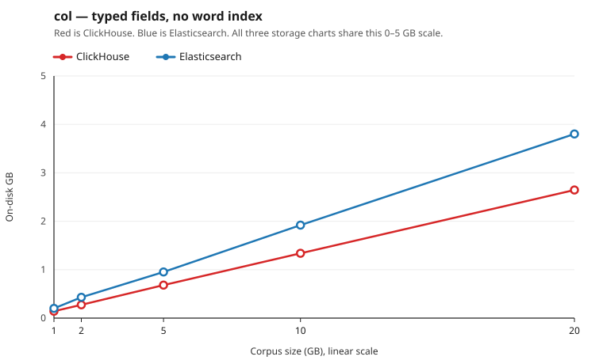
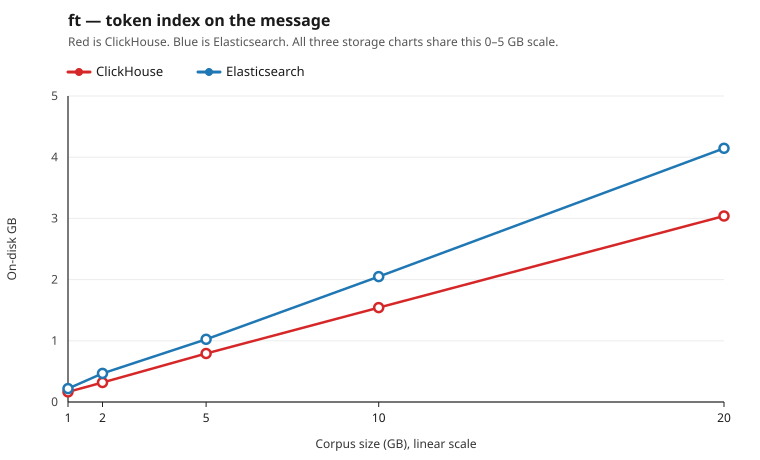
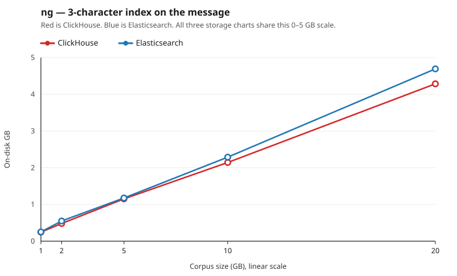
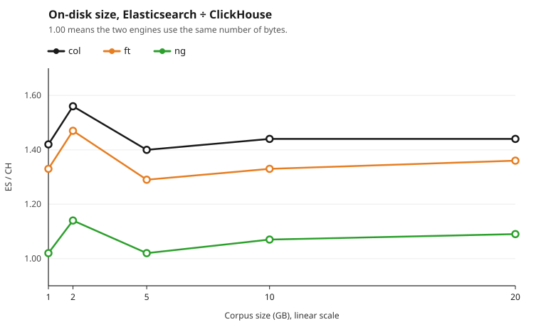
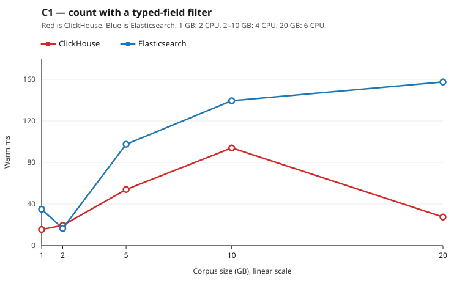
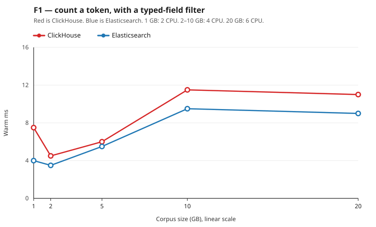
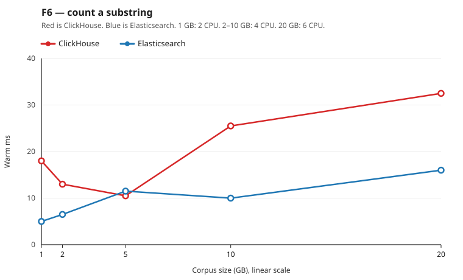

# ClickHouse and Elasticsearch, col / ft / ng, 1–20 GB

Summary of [report_CH_ES_1GB.md](report_CH_ES_1GB.md) for three layouts. `phrase` and `scan` are left out. Storage bytes can be compared across sizes. Search times cannot: 1 GB ran on 2 CPU / 2 GB, 2–10 GB on 4 CPU / 12 GB, and 20 GB on 6 CPU / 18 GB. Warm time is the average of repetitions 2 and 3 after a restart, with the page cache left in place.

| Arm | What it stores |
| --- | --- |
| col | Typed fields as columns, so a filter can read `cluster`, `level`, `app`, or `duration_ms` directly. The message is stored and has no word index. ClickHouse sorts by `Cluster`, `Namespace`, `App`, `Timestamp` and keeps a bloom filter on `TraceId`. Elasticsearch stores the same fields as doc values, sorts by `host.name` then `@timestamp`, and leaves `body` as a keyword that is not inverted. |
| ft | A token index on the message. A token is a run of letters and digits, so `zzq_s5` is `zzq` and `s5`. This arm does not store word order. |
| ng | An index of every overlapping 3-character slice of the message, so `abc` matches inside `traceabc`. ClickHouse uses `ngrams(3)`. Elasticsearch uses a `wildcard` field. |

## Storage

On-disk size after the load, merges idle. The three charts share one vertical scale. Red is ClickHouse. Blue is Elasticsearch. The horizontal axis is corpus size on a linear scale.

### col



### ft



### ng



### Elasticsearch ÷ ClickHouse



### Why the three lines

All three pairs grow with the corpus. From 5 GB to 20 GB each ratio sits still. The 2 GB point is the high point on every line because that is where Elasticsearch uses the most bytes per raw gigabyte (214 MB on `col`, against about 190 MB from 5 GB on).

**col** is the columnar pair. ClickHouse stores one compressed column per field, with dictionary encoding on the repeated strings. Elasticsearch `logsdb_columnar` stores doc values, and the keyword fields still carry a dictionary; `body` itself adds no inverted bytes. At 20 GB the ClickHouse columns are 2.58 GB and the Elasticsearch doc values are 3.67 GB. That gap is the line. The ratio stays near 1.44× (1.40×–1.56× across the five sizes).

**ft** is that same columnar store plus a token index. At 20 GB the ClickHouse token index is 469 MB and the Elasticsearch body postings are 273 MB. The larger ClickHouse index closes part of the doc-values gap, so this pair sits under `col`, near 1.33× (1.29×–1.47×).

**ng** is the columnar store plus every overlapping 3-character slice. At 20 GB the ClickHouse n-gram index is 1.73 GB and the Elasticsearch wildcard postings are 810 MB. The ClickHouse index is large enough to cancel most of the doc-values gap, so the totals nearly meet: 1.02×–1.14×, and 1.09× at 20 GB. The column stores underneath are still about 1.5× apart. The totals look close because the indexes point the other way.

## Search

Warm latency. Red is ClickHouse. Blue is Elasticsearch. Read these three charts inside one machine size. The 20 GB host has more CPUs than the 10 GB host, so a drop from 10 GB to 20 GB is not the query getting cheaper per byte.

### C1 — count events in 7 days with typed-field filtering

`cluster = dc1` over the whole 7 days. About 78% of events match. The message is not read.



ClickHouse sorts by `Cluster` first. Granules that sit entirely inside `dc1` are counted from the primary-key marks. At 20 GB the engine reads column data only for the boundary ranges: 7.45 million rows, 64 MB, and finishes in 27.5 ms. Elasticsearch has no inverted index on `cluster` in this mode, and its sort is `host.name` then `@timestamp`. Host names are shared by `dc1` and `dc2`, so the values are mixed through the column. C1 scans that column (`ScanningBinaryDocValuesTermQuery`) and takes 157.5 ms at 20 GB.

### F1 — count events containing a token in 7 days with typed-field filtering

The token is `zzq_s5`, and the typed filter is `cluster = dc1`. Hit counts are 16, 31, 79, 157, 312. A character sequence inside a longer token is F6.



Both engines use the token index. The token is rare, so the warm time stays under 12 ms at every size. Elasticsearch is a few milliseconds faster. Its profile is the token query plus a doc-values check on `cluster`.

### F6 — count a substring in 7 days

The substring is `abc`, including `abc` inside `traceabc`. Hit counts are 20, 40, 101, 201, 403. There is no typed-field filter.



Elasticsearch stays between 5 ms and 16 ms. The profile is `BinaryDvConfirmedAutomatonQuery` on the wildcard field. ClickHouse uses the n-gram index. Its warm times are 18, 13, 10.5, 25.5, and 32.5 ms. At 10 GB the three repetitions were 185, 233, and 36 ms, and the reported warm time is 25.5 ms. At 20 GB ClickHouse is 32.5 ms and Elasticsearch is 16 ms.

## Tables

`Storage Size (MB)` is bytes ÷ 1,000,000. `Query Latency (ms)` is the warm time. Import the CSV into Google Sheets if the markdown table does not split into columns.

| Data Size (GB) | Storage | Sorted Keys | Storage Size (MB) | Query Type | Query Latency (ms) | Note |
| ---: | --- | --- | ---: | --- | ---: | --- |
| 1 | ClickHouse col | Cluster / Namespace / App / Timestamp | 141.6 | Count events in 7 days with typed-field filtering | 15.5 | VM 2 CPU / 2 GB. Sort key starts with Cluster. C1 counts covered granules from the primary-key marks. |
| 1 | Elasticsearch col | host.name / @timestamp | 201.0 | Count events in 7 days with typed-field filtering | 35 | VM 2 CPU / 2 GB. C1 scans cluster doc values. Host names are shared by dc1 and dc2. |
| 1 | ClickHouse ft | Cluster / Namespace / App / Timestamp | 165.3 | Count events containing a token in 7 days with typed-field filtering | 7.5 | VM 2 CPU / 2 GB. Token index on the message. F1 looks up zzq_s5 and filters cluster = dc1. |
| 1 | Elasticsearch ft | host.name / @timestamp | 219.3 | Count events containing a token in 7 days with typed-field filtering | 4 | VM 2 CPU / 2 GB. Token index on the message, plus a cluster doc-values check. |
| 1 | ClickHouse ng | Cluster / Namespace / App / Timestamp | 247.3 | Count a substring in 7 days | 18 | VM 2 CPU / 2 GB. Every overlapping 3-character slice. F6 counts abc. |
| 1 | Elasticsearch ng | host.name / @timestamp | 253.4 | Count a substring in 7 days | 5 | VM 2 CPU / 2 GB. Wildcard field. F6 runs as a doc-values automaton over abc. |
| 2 | ClickHouse col | Cluster / Namespace / App / Timestamp | 274.9 | Count events in 7 days with typed-field filtering | 19.5 | VM 4 CPU / 12 GB. Sort key starts with Cluster. C1 counts covered granules from the primary-key marks. |
| 2 | Elasticsearch col | host.name / @timestamp | 429.0 | Count events in 7 days with typed-field filtering | 16.5 | VM 4 CPU / 12 GB. C1 scans cluster doc values. Host names are shared by dc1 and dc2. |
| 2 | ClickHouse ft | Cluster / Namespace / App / Timestamp | 318.7 | Count events containing a token in 7 days with typed-field filtering | 4.5 | VM 4 CPU / 12 GB. Token index on the message. F1 looks up zzq_s5 and filters cluster = dc1. |
| 2 | Elasticsearch ft | host.name / @timestamp | 468.4 | Count events containing a token in 7 days with typed-field filtering | 3.5 | VM 4 CPU / 12 GB. Token index on the message, plus a cluster doc-values check. |
| 2 | ClickHouse ng | Cluster / Namespace / App / Timestamp | 482.4 | Count a substring in 7 days | 13 | VM 4 CPU / 12 GB. Every overlapping 3-character slice. F6 counts abc. |
| 2 | Elasticsearch ng | host.name / @timestamp | 550.4 | Count a substring in 7 days | 6.5 | VM 4 CPU / 12 GB. Wildcard field. F6 runs as a doc-values automaton over abc. |
| 5 | ClickHouse col | Cluster / Namespace / App / Timestamp | 682.3 | Count events in 7 days with typed-field filtering | 54 | VM 4 CPU / 12 GB. Sort key starts with Cluster. C1 counts covered granules from the primary-key marks. |
| 5 | Elasticsearch col | host.name / @timestamp | 953.4 | Count events in 7 days with typed-field filtering | 97.5 | VM 4 CPU / 12 GB. C1 scans cluster doc values. Host names are shared by dc1 and dc2. |
| 5 | ClickHouse ft | Cluster / Namespace / App / Timestamp | 792.9 | Count events containing a token in 7 days with typed-field filtering | 6 | VM 4 CPU / 12 GB. Token index on the message. F1 looks up zzq_s5 and filters cluster = dc1. |
| 5 | Elasticsearch ft | host.name / @timestamp | 1025.5 | Count events containing a token in 7 days with typed-field filtering | 5.5 | VM 4 CPU / 12 GB. Token index on the message, plus a cluster doc-values check. |
| 5 | ClickHouse ng | Cluster / Namespace / App / Timestamp | 1153.7 | Count a substring in 7 days | 10.5 | VM 4 CPU / 12 GB. Every overlapping 3-character slice. F6 counts abc. |
| 5 | Elasticsearch ng | host.name / @timestamp | 1176.2 | Count a substring in 7 days | 11.5 | VM 4 CPU / 12 GB. Wildcard field. F6 runs as a doc-values automaton over abc. |
| 10 | ClickHouse col | Cluster / Namespace / App / Timestamp | 1337.6 | Count events in 7 days with typed-field filtering | 94 | VM 4 CPU / 12 GB. Sort key starts with Cluster. C1 counts covered granules from the primary-key marks. |
| 10 | Elasticsearch col | host.name / @timestamp | 1919.7 | Count events in 7 days with typed-field filtering | 139.5 | VM 4 CPU / 12 GB. C1 scans cluster doc values. Host names are shared by dc1 and dc2. |
| 10 | ClickHouse ft | Cluster / Namespace / App / Timestamp | 1543.1 | Count events containing a token in 7 days with typed-field filtering | 11.5 | VM 4 CPU / 12 GB. Token index on the message. F1 looks up zzq_s5 and filters cluster = dc1. |
| 10 | Elasticsearch ft | host.name / @timestamp | 2048.7 | Count events containing a token in 7 days with typed-field filtering | 9.5 | VM 4 CPU / 12 GB. Token index on the message, plus a cluster doc-values check. |
| 10 | ClickHouse ng | Cluster / Namespace / App / Timestamp | 2143.4 | Count a substring in 7 days | 25.5 | VM 4 CPU / 12 GB. Repetitions were 185, 233, and 36 ms. Reported warm time is 25.5 ms. |
| 10 | Elasticsearch ng | host.name / @timestamp | 2288.6 | Count a substring in 7 days | 10 | VM 4 CPU / 12 GB. Wildcard field. F6 runs as a doc-values automaton over abc. |
| 20 | ClickHouse col | Cluster / Namespace / App / Timestamp | 2645.5 | Count events in 7 days with typed-field filtering | 27.5 | VM 6 CPU / 18 GB. C1 reads 7.45 million boundary rows and 64 MB. |
| 20 | Elasticsearch col | host.name / @timestamp | 3803.2 | Count events in 7 days with typed-field filtering | 157.5 | VM 6 CPU / 18 GB. C1 scans cluster doc values. Host names are shared by dc1 and dc2. |
| 20 | ClickHouse ft | Cluster / Namespace / App / Timestamp | 3040.2 | Count events containing a token in 7 days with typed-field filtering | 11 | VM 6 CPU / 18 GB. Token index is 469 MB. F1 looks up zzq_s5 and filters cluster = dc1. |
| 20 | Elasticsearch ft | host.name / @timestamp | 4146.0 | Count events containing a token in 7 days with typed-field filtering | 9 | VM 6 CPU / 18 GB. Body postings are 273 MB, plus a cluster doc-values check. |
| 20 | ClickHouse ng | Cluster / Namespace / App / Timestamp | 4286.2 | Count a substring in 7 days | 32.5 | VM 6 CPU / 18 GB. N-gram index is 1.73 GB. F6 counts abc. |
| 20 | Elasticsearch ng | host.name / @timestamp | 4693.1 | Count a substring in 7 days | 16 | VM 6 CPU / 18 GB. Wildcard postings are 810 MB. F6 runs as a doc-values automaton over abc. |

### Elasticsearch ÷ ClickHouse

| Data Size (GB) | col | ft | ng |
| ---: | ---: | ---: | ---: |
| 1 | 1.42 | 1.33 | 1.02 |
| 2 | 1.56 | 1.47 | 1.14 |
| 5 | 1.40 | 1.29 | 1.02 |
| 10 | 1.44 | 1.33 | 1.07 |
| 20 | 1.44 | 1.36 | 1.09 |

```csv
Data Size (GB),Storage,Sorted Keys,Storage Size (MB),Query Type,Query Latency (ms),Note
1,ClickHouse col,Cluster / Namespace / App / Timestamp,141.6,Count events in 7 days with typed-field filtering,15.5,VM 2 CPU / 2 GB. Sort key starts with Cluster. C1 counts covered granules from the primary-key marks.
1,Elasticsearch col,host.name / @timestamp,201.0,Count events in 7 days with typed-field filtering,35,VM 2 CPU / 2 GB. C1 scans cluster doc values. Host names are shared by dc1 and dc2.
1,ClickHouse ft,Cluster / Namespace / App / Timestamp,165.3,Count events containing a token in 7 days with typed-field filtering,7.5,VM 2 CPU / 2 GB. Token index on the message. F1 looks up zzq_s5 and filters cluster = dc1.
1,Elasticsearch ft,host.name / @timestamp,219.3,Count events containing a token in 7 days with typed-field filtering,4,VM 2 CPU / 2 GB. Token index on the message plus a cluster doc-values check.
1,ClickHouse ng,Cluster / Namespace / App / Timestamp,247.3,Count a substring in 7 days,18,VM 2 CPU / 2 GB. Every overlapping 3-character slice. F6 counts abc.
1,Elasticsearch ng,host.name / @timestamp,253.4,Count a substring in 7 days,5,VM 2 CPU / 2 GB. Wildcard field. F6 runs as a doc-values automaton over abc.
2,ClickHouse col,Cluster / Namespace / App / Timestamp,274.9,Count events in 7 days with typed-field filtering,19.5,VM 4 CPU / 12 GB. Sort key starts with Cluster. C1 counts covered granules from the primary-key marks.
2,Elasticsearch col,host.name / @timestamp,429.0,Count events in 7 days with typed-field filtering,16.5,VM 4 CPU / 12 GB. C1 scans cluster doc values. Host names are shared by dc1 and dc2.
2,ClickHouse ft,Cluster / Namespace / App / Timestamp,318.7,Count events containing a token in 7 days with typed-field filtering,4.5,VM 4 CPU / 12 GB. Token index on the message. F1 looks up zzq_s5 and filters cluster = dc1.
2,Elasticsearch ft,host.name / @timestamp,468.4,Count events containing a token in 7 days with typed-field filtering,3.5,VM 4 CPU / 12 GB. Token index on the message plus a cluster doc-values check.
2,ClickHouse ng,Cluster / Namespace / App / Timestamp,482.4,Count a substring in 7 days,13,VM 4 CPU / 12 GB. Every overlapping 3-character slice. F6 counts abc.
2,Elasticsearch ng,host.name / @timestamp,550.4,Count a substring in 7 days,6.5,VM 4 CPU / 12 GB. Wildcard field. F6 runs as a doc-values automaton over abc.
5,ClickHouse col,Cluster / Namespace / App / Timestamp,682.3,Count events in 7 days with typed-field filtering,54,VM 4 CPU / 12 GB. Sort key starts with Cluster. C1 counts covered granules from the primary-key marks.
5,Elasticsearch col,host.name / @timestamp,953.4,Count events in 7 days with typed-field filtering,97.5,VM 4 CPU / 12 GB. C1 scans cluster doc values. Host names are shared by dc1 and dc2.
5,ClickHouse ft,Cluster / Namespace / App / Timestamp,792.9,Count events containing a token in 7 days with typed-field filtering,6,VM 4 CPU / 12 GB. Token index on the message. F1 looks up zzq_s5 and filters cluster = dc1.
5,Elasticsearch ft,host.name / @timestamp,1025.5,Count events containing a token in 7 days with typed-field filtering,5.5,VM 4 CPU / 12 GB. Token index on the message plus a cluster doc-values check.
5,ClickHouse ng,Cluster / Namespace / App / Timestamp,1153.7,Count a substring in 7 days,10.5,VM 4 CPU / 12 GB. Every overlapping 3-character slice. F6 counts abc.
5,Elasticsearch ng,host.name / @timestamp,1176.2,Count a substring in 7 days,11.5,VM 4 CPU / 12 GB. Wildcard field. F6 runs as a doc-values automaton over abc.
10,ClickHouse col,Cluster / Namespace / App / Timestamp,1337.6,Count events in 7 days with typed-field filtering,94,VM 4 CPU / 12 GB. Sort key starts with Cluster. C1 counts covered granules from the primary-key marks.
10,Elasticsearch col,host.name / @timestamp,1919.7,Count events in 7 days with typed-field filtering,139.5,VM 4 CPU / 12 GB. C1 scans cluster doc values. Host names are shared by dc1 and dc2.
10,ClickHouse ft,Cluster / Namespace / App / Timestamp,1543.1,Count events containing a token in 7 days with typed-field filtering,11.5,VM 4 CPU / 12 GB. Token index on the message. F1 looks up zzq_s5 and filters cluster = dc1.
10,Elasticsearch ft,host.name / @timestamp,2048.7,Count events containing a token in 7 days with typed-field filtering,9.5,VM 4 CPU / 12 GB. Token index on the message plus a cluster doc-values check.
10,ClickHouse ng,Cluster / Namespace / App / Timestamp,2143.4,Count a substring in 7 days,25.5,VM 4 CPU / 12 GB. Repetitions were 185 233 and 36 ms. Reported warm time is 25.5 ms.
10,Elasticsearch ng,host.name / @timestamp,2288.6,Count a substring in 7 days,10,VM 4 CPU / 12 GB. Wildcard field. F6 runs as a doc-values automaton over abc.
20,ClickHouse col,Cluster / Namespace / App / Timestamp,2645.5,Count events in 7 days with typed-field filtering,27.5,VM 6 CPU / 18 GB. C1 reads 7.45 million boundary rows and 64 MB.
20,Elasticsearch col,host.name / @timestamp,3803.2,Count events in 7 days with typed-field filtering,157.5,VM 6 CPU / 18 GB. C1 scans cluster doc values. Host names are shared by dc1 and dc2.
20,ClickHouse ft,Cluster / Namespace / App / Timestamp,3040.2,Count events containing a token in 7 days with typed-field filtering,11,VM 6 CPU / 18 GB. Token index is 469 MB. F1 looks up zzq_s5 and filters cluster = dc1.
20,Elasticsearch ft,host.name / @timestamp,4146.0,Count events containing a token in 7 days with typed-field filtering,9,VM 6 CPU / 18 GB. Body postings are 273 MB plus a cluster doc-values check.
20,ClickHouse ng,Cluster / Namespace / App / Timestamp,4286.2,Count a substring in 7 days,32.5,VM 6 CPU / 18 GB. N-gram index is 1.73 GB. F6 counts abc.
20,Elasticsearch ng,host.name / @timestamp,4693.1,Count a substring in 7 days,16,VM 6 CPU / 18 GB. Wildcard postings are 810 MB. F6 runs as a doc-values automaton over abc.
```
