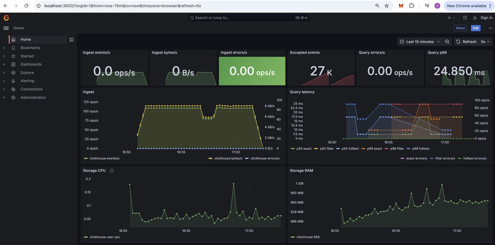

# Deploy

`VM01` is the log generator. `VM02` is ClickHouse. `VM03` is the other storage
host. Grafana stays on `VM01`. Logs go from `VM01` to `VM02`. ClickHouse does
not push metrics. Prometheus on `VM01` pulls them from `VM02` port 9363. Phase 3
uses `VM02` for ClickHouse and Loki, and `VM03` for Elasticsearch and
VictoriaLogs.

The checked-in scenario auth is `admin` / `admin`. Use that pair for
`CH_USER` and `CH_PASSWORD`.

## Copy the source

From the laptop, in the repo root. `data/messages.txt` is not required. The
image uses the one-line sample in `deploy/docker/messages.txt`, and the 2GiB
preload is built on `VM01` by `write`.

```bash
rsync -a syscon-bench/deploy/vm/ VM02:syscon-bench/deploy/vm/
rsync -a --exclude '.git' --exclude 'data/messages.txt' syscon-bench/ VM01:syscon-bench/
```

## Docker on each VM

```bash
sudo apt-get update
sudo apt-get install -y docker.io docker-compose-v2
sudo usermod -aG docker "$USER"
```

Close SSH and connect again. If `docker ps` still says permission denied, the
current shell never joined the `docker` group:

```bash
newgrp docker
id
docker ps
```

`id` must list `docker`. Stay in that shell for the commands below. Do not
install the Docker snap or `podman-docker`.

## Mock on VM01

ClickHouse, the generator, Prometheus, and Grafana all run on `VM01`.

```bash
ssh VM01
cd syscon-bench/deploy/docker
./run.sh clickhouse --keep
```

Grafana has no login. From the laptop:

```text
http://<VM01-ip>:3000
```

The port is 3000. If that page does not load, tunnel it:

```bash
ssh -L 3000:127.0.0.1:3000 VM01
```

Then open http://localhost:3000. The home board is the ingest rate, query
latency, ClickHouse CPU, and ClickHouse memory from that run.



Stop the mock before the split run. Both stacks publish ports 3000 and 9090.

```bash
docker compose --profile clickhouse down
```

## Split run

### VM02, ClickHouse

Docker is installed the same way as on `VM01`. Tailscale is already running.
The install script reads `tailscale ip -4` and does not start the generator.

```bash
ssh VM02
cd syscon-bench/deploy/vm
CH_USER=admin CH_PASSWORD=admin ./install-clickhouse.sh
```

The last line is the endpoint, `http://<tailscale-ip>:8123`. `syscon.logs` is
empty. Metrics listen on port 9363. Async insert is durable:
`async_insert = 1` and `wait_for_async_insert = 1`.

### VM01, generator

Use the URL printed on `VM02`.

```bash
ssh VM01
cd syscon-bench/deploy/generator
export STORAGE_ENDPOINT=http://<tailscale-ip>:8123
export CH_USER=admin
export CH_PASSWORD=admin
curl -fsS "$STORAGE_ENDPOINT/ping"
./preload.sh
./run.sh
```

`curl` prints `Ok.`. If it hangs, `VM02` is not accepting `VM01` on port 8123.

`preload.sh` writes the 2GiB file and Vector ingests it. Scenario 01 does not
start. The script exits unless the row count grew by every line written and
`system.asynchronous_insert_log` gained a row.

`run.sh` warns if that preload is missing and still runs scenario 01 for the full hour.
The generator shares the network namespace with the Vector sidecar and posts
logs to `127.0.0.1:8686`. Queries go directly to `VM02`. Prometheus on `VM01`
scrapes `VM02` at `<that-same-host>:9363`.

Grafana remains `http://<VM01-ip>:3000`.

For a short connectivity check before the 2GiB file:

```bash
BYTES=10000000 ./preload.sh
```

The formal preload is the default, 2147483648 bytes.
